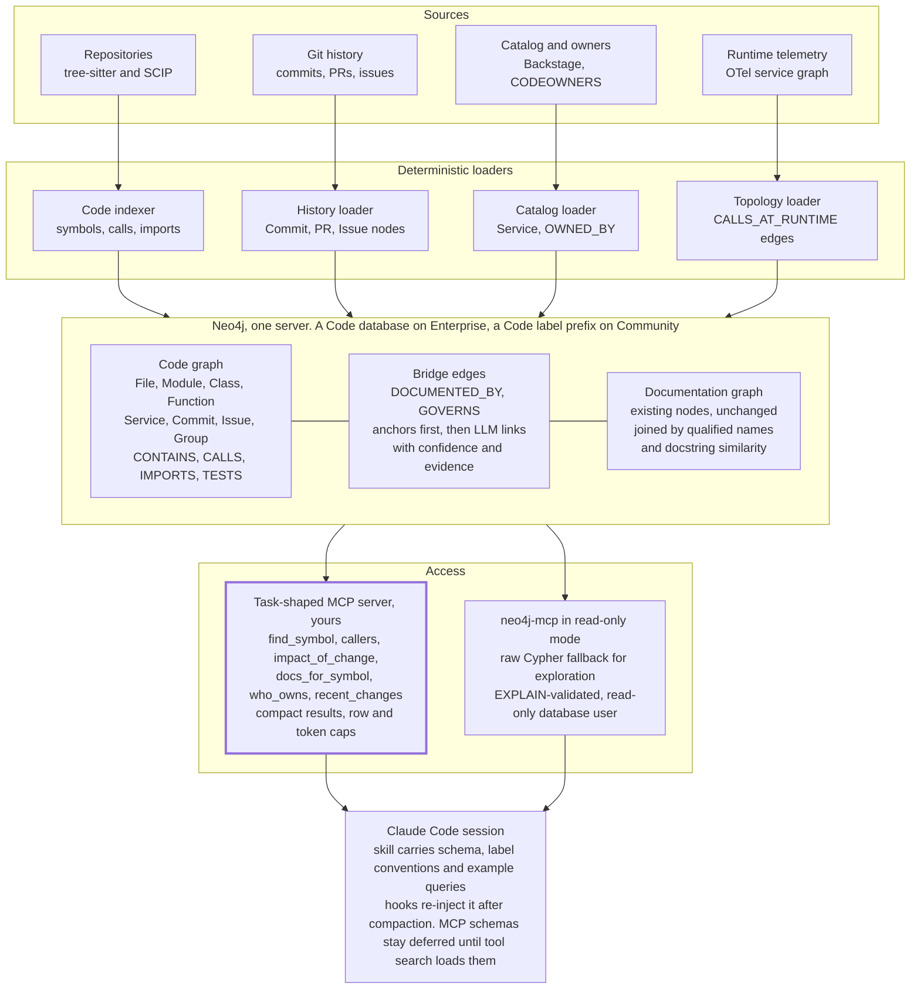

# Graph-Based Codebase Context for Claude Code

1 October 2026 · Osian Shelley

A research report on off-the-shelf graph approaches for understanding and querying large codebases from Claude Code, written for an enterprise that already operates a Neo4j documentation knowledge graph. The seven raw research sweeps behind it (tool surveys, academic evidence, Claude Code documentation, Neo4j ecosystem, enterprise security, documentation-to-code linking) are in [`research-notes/`](research-notes/).

**Contents**

1. [Executive summary](#executive-summary)
2. [What Claude Code does natively, and where it runs out](#what-claude-code-does-natively-and-where-it-runs-out)
3. [Eight families of graph, and what each answers](#eight-families-of-graph-and-what-each-answers)
4. [Open-source tools and MCP servers](#open-source-tools-and-mcp-servers)
5. [Commercial platforms](#commercial-platforms)
6. [What the research evidence shows](#what-the-research-evidence-shows)
7. [Reusing the Neo4j you already run](#reusing-the-neo4j-you-already-run)
8. [Enterprise considerations](#enterprise-considerations)
9. [Recommendations](#recommendations)
10. [Sources](#sources)

## Executive summary

A graph layer is worth adopting for enterprise Claude Code, but only in one shape: a thin, deterministic code graph in the Neo4j you already run, bridged to the existing documentation graph, and exposed through six to eight task-shaped MCP tools with read-only Cypher as a fallback. Nothing off the shelf delivers that combination, and the evidence does not support heavier designs.

- Claude Code ships no code index by design. Its lead engineer reports agentic search "outperformed everything" and avoided index drift and index security; the admitted cost is latency and tokens. Native tooling (LSP plugins, subagents, compaction, deferred MCP schemas) leaves three gaps on large codebases: multi-hop structural questions, persistence of structural knowledge across sessions, and any link from documentation, tickets and ownership to code.
- The research record is consistent. Static-analysis graphs lift localisation reliably and cut tokens when they replace exploration turns, but end-to-end gains over a strong grep agent are 2 to 5 points and often inside measurement noise, and every system that dumped subgraphs into the prompt lost accuracy. The one controlled graph-first study traded a nine-point quality drop for a ten-fold token saving. Lexical search mattered three times more than graph traversal inside the best graph agent.
- Commercially, only Sourcegraph (SCIP, GA MCP server, self-hosted) and Moderne (Lossless Semantic Trees, air-gapped) expose compiler-grade structure to Claude Code. No vendor runs on or exports to a customer Neo4j. The market churned heavily in 2025 and 2026.
- In open source, CodeGraphContext and Cognee are the two maintained, permissively licensed tools that write a symbol graph straight to Neo4j; most others are per-developer SQLite indexes, and two Neo4j-native projects are blocked by licensing.
- Neo4j itself supplies the access layer (an official read-only MCP server, a Labs server with token caps), the analytics (Personalized PageRank, Leiden), and the controls (reader-only users, property-level privileges). Agents writing their own Cypher reach under 5% session-level correctness in the latest benchmark, which is why curated tools come first.
- The enterprise risk is untrusted text from the graph reaching an agent with write access. Four controls dominate: a reader-only database identity, parameterised tools instead of raw Cypher, egress control on both hosts, and policy through managed settings rather than CLAUDE.md. Graph results leave the boundary as tool results; the graph does not.

The recommended path is a two-week native baseline, a one-quarter structural pilot on one to three repositories measured with paired tests against plain Claude Code and a local-first tool, and a gated second phase that bridges to the documentation graph. If the pilot does not beat the baseline on multi-hop questions at lower tokens, stopping at LSP plugins and subagents is the right outcome.

## What Claude Code does natively, and where it runs out

Claude Code deliberately ships no code index, so any graph layer is an add-on that must beat grep on cost per answer. Its lead engineer said the team tried retrieval-augmented generation early, then settled on agentic search with glob and grep because it "outperformed everything. By a lot", avoided an index where "the code drifts out of sync", and removed the question of where a sensitive index lives ([Latent Space interview with Boris Cherny, 7 May 2025](https://www.latent.space/p/claude-code)). The admitted price is "latency and tokens", and that price grows with codebase size.

The harness manages context with a fixed set of mechanisms. The table lists each one and the limit it leaves on a large enterprise codebase, drawn from [How Claude Code works](https://code.claude.com/docs/en/how-claude-code-works), [Explore the context window](https://code.claude.com/docs/en/context-window), and [Best practices](https://code.claude.com/docs/en/best-practices).

| Mechanism | What it does | Limit it leaves |
| --- | --- | --- |
| [CLAUDE.md hierarchy](https://code.claude.com/docs/en/memory) (managed, user, project, local), `@` imports, path-scoped rules in `.claude/rules` | Loads conventions every session; rules load only when a matching path is read | Advisory prose. The docs warn that bloated files get ignored. Not a queryable model of the code |
| Auto memory | Loads the first 200 lines or 25 KB of `MEMORY.md` at startup | Per machine and per project, not shared across a team |
| Agentic search (Glob, Grep, Read) | Just-in-time retrieval using file paths as lightweight identifiers | Every file read lands in context. The docs state "file reads dominate context usage". A multi-hop dependency question costs one search-and-read cycle per hop |
| [Code intelligence plugins](https://code.claude.com/docs/en/plugins/code-intelligence) (LSP) | Diagnostics after edits, go-to-definition and find-references through a read-only `LSP` tool, 13 official languages | One live language server per language per machine. No persistent or cross-repository graph. Not started in cloud sessions |
| [Subagents](https://code.claude.com/docs/en/sub-agents) (fresh context, or fork) | File reads happen in the subagent and only its summary returns. The docs' example reads 6,100 tokens and returns 420 | The summary is only as good as what grep found |
| Compaction (`/compact`, auto) | Clears old tool outputs, then summarises. Re-injects CLAUDE.md, memory, MCP tool names, up to five recently modified files, and invoked skills | "Detailed instructions from early in the conversation may be lost." Structural facts about the code are regenerated each session, never stored |
| [MCP](https://code.claude.com/docs/en/mcp) with tool search | Tool schemas are deferred by default and loaded on demand. Results over 25,000 tokens are spilled to a file | The natural insertion point for a graph. Tool results must be designed for the limit |
| [Hooks](https://code.claude.com/docs/en/hooks) | `SessionStart` (including after compaction) and `UserPromptSubmit` can inject `additionalContext` deterministically | Static unless the hook queries something |
| Skills | Progressive disclosure, descriptions only until invoked | Workflow knowledge, not code structure |

Anthropic's own engineering guidance reinforces the pattern. Agents should hold "lightweight identifiers (file paths, stored queries, web links, etc.)" and load data just in time, with compaction, structured note-taking, and sub-agents as the three long-horizon techniques ([Effective context engineering for AI agents, 29 Sep 2025](https://www.anthropic.com/engineering/effective-context-engineering-for-ai-agents)). The two token sinks it names are tool definitions and tool results. The Tool Search Tool cut definition overhead from about 72K to 8.7K tokens and lifted Opus 4.5 tool-selection accuracy from 79.5% to 88.1% ([Advanced tool use, 24 Nov 2025](https://www.anthropic.com/engineering/advanced-tool-use)). Running MCP calls as code and filtering results before they reach the model cut one workflow from 150,000 to 2,000 tokens ([Code execution with MCP, 4 Nov 2025](https://www.anthropic.com/engineering/code-execution-with-mcp)). A graph MCP server should be built to the same two rules: few, well-described tools, and compact results.

Three gaps remain on a large codebase, and they define what a graph layer must deliver:

1. Multi-hop structural questions ("what breaks if this interface changes", "which services reach this endpoint") cost a search-and-read cycle per hop, and every hop's file contents stay in context until compaction.
2. Nothing persists structural knowledge between sessions except prose in CLAUDE.md and auto memory. Each session rediscovers the architecture.
3. Documentation, tickets, ownership, and design decisions are not linked to code at all. The agent cannot ask "which runbook covers this module" without a human pointing at it.

Section 6 tests whether graphs close these gaps more cheaply than grep. The short version: the evidence supports graphs for localisation and cross-file reasoning in large repositories, and does not support them for simple lookups.

## Eight families of graph, and what each answers

"Graph approach" covers eight distinct families that differ in what they capture, how they are built, and how fast they go stale. The first four are deterministic and cheap to keep fresh. The LLM-extracted families are expensive to build and must carry confidence and evidence on every edge. An enterprise design normally combines three or four of them, with deterministic structure first and inference layered on top, which is the lesson Google draws from its own migrations work ("LLM plus AST, better together", [arXiv 2501.06972](https://arxiv.org/abs/2501.06972)).

| Family | What it captures | How it is built | Best for | Cost and staleness | Examples |
| --- | --- | --- | --- | --- | --- |
| Symbol and reference graph | Definitions, references, imports, inheritance for every symbol | tree-sitter (approximate) or compiler, LSP and SCIP (precise) | Go-to-definition, find-references, rename safety, impact radius | Deterministic, incremental per file. Live LSP servers hold it in memory; SCIP and Kythe persist it | Claude Code [LSP plugins](https://code.claude.com/docs/en/plugins/code-intelligence), [SCIP](https://github.com/sourcegraph/scip), [Kythe](https://kythe.io/docs/schema/), Glean, CodeGraphContext, codebase-memory-mcp |
| Call and dependency graph | Who calls whom, module and package dependencies, build targets, which tests cover what | Static call resolution, build-system APIs (CMake File API, CTest), coverage | Blast radius, planning multi-file edits, affected tests, localisation | Precise for static languages. Misses dynamic dispatch and cross-service calls | [CodePlan](https://arxiv.org/abs/2309.12499), [Repository Intelligence Graph](https://arxiv.org/abs/2601.10112), [LocAgent](https://arxiv.org/abs/2503.09089), [CGM](https://arxiv.org/abs/2505.16901) |
| Code property graph | AST, control flow and data flow in one graph | Language frontends into Joern or CodeQL | Security review, taint tracking, program slicing, vulnerability patterns | Heavy to build and query. Right for audits, wrong for daily navigation | [Joern](https://github.com/joernio/joern), [codebadger](https://github.com/Lekssays/codebadger), CodeQL |
| Runtime and service topology | Service-to-service calls with latency and error rates, HTTP route to the client that calls it | OpenTelemetry spans, eBPF flow logs, service mesh | Cross-repository dependencies that static analysis cannot see | Always fresh but only sees exercised paths | [OTel servicegraph connector](https://github.com/open-telemetry/opentelemetry-collector-contrib/blob/main/connector/servicegraphconnector/README.md), [Netflix Service Topology](https://www.infoq.com/news/2026/06/netflix-microservices-realtime/), stakgraph route linking |
| History and co-change graph | Commits, authors, pull requests, files that change together, expertise decay | git log mining | Hidden coupling, who to ask, why a change was made | Deterministic and cheap. Commit history was the decisive signal in Microsoft's [Code Researcher](https://arxiv.org/abs/2506.11060) | [code-maat](https://github.com/adamtornhill/code-maat), [checkOwners](https://dev.to/smusali/meet-checkowners-confidence-scored-codeowners-from-your-git-history-4280), codebase-memory-mcp FILE\_CHANGES\_WITH edges |
| Traceability graph (docs, requirements, issues, ADRs to code) | Which document, requirement, ticket or decision governs which code | Deterministic anchors first (paths, symbol tokens, issue keys, CODEOWNERS, Backstage annotations), then retrieval plus LLM classification | "Which runbook covers this module", "what governs this file", "which commits fixed this issue" | Precision depends on tier. Inferred links need confidence, evidence span and staleness | [LiSSA](https://fuchss.org/conferences/icse25/) and [ARDoCo](https://arxiv.org/abs/2606.28064), Swimm smart tokens, [adr-graph](https://github.com/democratize-technology/adr-graph), [repowise](https://repowise.dev/guides/decisions-adr), [LinkAnchor](https://arxiv.org/abs/2508.12232), [Backstage TechDocs](https://backstage.io/docs/features/techdocs/) |
| LLM-extracted knowledge graph (GraphRAG) | Entities, concepts and relations from prose: design docs, ADRs, comments, PR bodies, optionally summarised by community | LLM entity and relation extraction, Leiden communities, hierarchical summaries | "Why" questions, architecture overviews, synthesis across many documents | Expensive to build and drifts. GraphRAG-Bench measured 89k to 655k indexing tokens per corpus across frameworks. This is what your existing documentation graph already is | [MS GraphRAG](https://arxiv.org/abs/2404.16130), LightRAG, HippoRAG2, Cognee and Graphify document paths |
| Agent memory graph (temporal) | Facts an agent learned, decisions taken, session notes, each with a validity interval | LLM extraction from conversations and tool results | Persistence across sessions, team-shared learnings, compaction survival | Not a model of the code. Pairs with any of the above | [Graphiti](https://github.com/getzep/graphiti), Cognee, Neo4j mcp-neo4j-memory |

Two further dimensions cut across the families and matter more for Claude Code than the family itself. The first is where the graph lives: in a live process (an LSP server, gone when the session ends), in a persisted store you own (Neo4j, SQLite), or as a batch export. Only a persisted store survives compaction and is shared across a team. The second is how the agent queries it: through a handful of task-shaped tools (impact, trace, who\_owns, docs\_for), through raw Cypher, or through graph algorithms such as Personalized PageRank that return a ranked subgraph. The evidence in section 6 favours task-shaped tools, because agents under-use raw graph access without explicit guidance.

The benchmark that best isolates the value of structure in general retrieval is [GraphRAG-Bench](https://arxiv.org/abs/2506.05690) (ICLR 2026). Plain vector RAG matched or beat graph retrieval on simple fact lookup, graph retrieval won on multi-hop reasoning and contextual summarisation, and graph retrieval stayed stable as the corpus grew while RAG's complex-reasoning accuracy fell from 58.64% to 43.20% between a 56k-token and a 1,132k-token corpus. Its design guidance transfers directly to a code graph: prioritise precise retrieval over exhaustive coverage, build dense well-connected graphs rather than large ones, and actively bound context growth, since the heaviest framework it tested expanded prompts from 7,800 to 40,000 tokens as task difficulty rose.

## Open-source tools and MCP servers

Two actively maintained, permissively licensed tools write a symbol graph straight into an external Neo4j and expose it to Claude Code: CodeGraphContext and Cognee. A dozen local-first tools do the same job into SQLite on each developer's machine, and three Neo4j-native projects are too immature or unlicensed to adopt. Star counts, licences and push dates below come from the GitHub API on 1 Oct 2026, not from READMEs. One caution: five of the most-starred repositories were created in 2026 and already show 30k to 123k stars while their Hacker News threads peak at 12 points, so in that cohort weigh commit cadence, licence and published evidence over stars.

| Tool | Parser | Backend | Languages | Claude Code integration | Licence | Stars, last push | Enterprise fit |
| --- | --- | --- | --- | --- | --- | --- | --- |
| [CodeGraphContext](https://github.com/CodeGraphContext/CodeGraphContext) | tree-sitter plus SCIP (scip-clang, scip-dotnet) | FalkorDB Lite, Kuzu, or external Neo4j | 23 | 21 MCP tools: find\_callers, class\_hierarchy, dead\_code, module\_deps, plus read-only execute\_cypher\_query; watch mode | MIT | 4.2k, 29 Sep 2026 | Best Neo4j option. Single maintainer at 0.5.x; v0.5.7 fixed "silent data loss" in four parsers; no published accuracy |
| [Cognee](https://github.com/topoteretes/cognee) | AST for code, LLM extraction for documents | Neo4j recommended for production; also Aura, Neptune, Kuzu | Not stated | Native Claude Code plugin hooking SessionStart, UserPromptSubmit, PostToolUse, PreCompact; MCP tools remember, recall, code\_search | Apache-2.0 | 31.3k, 1 Oct 2026 | Company-backed. Code graph is a side feature of a memory platform. Telemetry on by default, set `TELEMETRY_DISABLED=true` |
| [code-graph-rag](https://github.com/vitali87/code-graph-rag) | tree-sitter sharpened by libclang, go/types, Roslyn, javac, Jedi | Memgraph (hard dependency) plus Qdrant | 13 full, 8 partial | MCP server; natural-language Cypher, AST patching, dead-code, eBPF trace ingestion | MIT | 5.2k, 1 Oct 2026 | Deepest parser stack; the only project selling on-prem and air-gapped support. Second graph database to run; Neo4j compatibility not claimed |
| [Graphify](https://github.com/safishamsi/graphify) | tree-sitter, no LLM touches code; LLM for docs and PDFs | graph.json; exports Cypher for Neo4j | 37 grammars | Skill plus PreToolUse hooks plus MCP; post-commit incremental rebuild | Apache-2.0 | 123k, 30 Sep 2026 | Neo4j is a batch export, not the live store. Anomalous star growth for a six-month-old repo |
| [codebase-memory-mcp](https://github.com/DeusData/codebase-memory-mcp) | tree-sitter (162 grammars) plus LSP type resolution | SQLite, local | 162 claimed | 17 MCP tools; cross-repo CROSS\_\* edges; background re-index | MIT | 45.6k, 1 Oct 2026 | Only tool with a published evaluation ([arXiv 2603.27277](https://arxiv.org/abs/2603.27277)): 83% answer quality vs 92% for a file-exploration agent at ten times fewer tokens. No Neo4j |
| [code-review-graph](https://github.com/tirth8205/code-review-graph) | tree-sitter | SQLite | about 40 | 30 MCP tools; installs four skills; content-hash incremental | MIT | 31.9k, 18 Sep 2026 | Self-benchmark claims median 63x token reduction; README admits its impact recall is circular. No Neo4j |
| [codegraph](https://github.com/colbymchenry/codegraph) (colbymchenry) | tree-sitter in Rust | SQLite with FTS5 | 20 plus 10 | MCP with OS file-event auto-sync | MIT | 72.8k, 1 Oct 2026 | Local-first, single repo. Self-run benchmark only |
| [GitNexus](https://github.com/abhigyanpatwari/GitNexus) | tree-sitter | LadybugDB | 16 | 19 MCP tools including impact, trace, cypher; read-only flag | PolyForm Noncommercial | 47.7k, 1 Oct 2026 | Blocked for enterprise use by the licence |
| [stakgraph](https://github.com/stakwork/stakgraph) | tree-sitter plus optional LSP | Neo4j | 16 | MCP tools stakgraph\_search, map, code, shortest\_path; async ingestion; links backend routes to frontend calls across repos | None found | 112, 1 Oct 2026 | Would be a top pick with a licence. Ask Stakwork |
| [Potpie](https://github.com/potpie-ai/potpie) | tree-sitter | Neo4j per its March 2026 engineering post; current default unverified | Not stated | Skills only; MCP removed in v2.0 | Apache-2.0 | 5.7k, 30 Sep 2026 | Mid-rewrite. Watch, do not adopt |
| [Serena](https://github.com/oraios/serena) | LSP, no persistent graph | None | 40 plus | MCP; find\_symbol, find\_referencing\_symbols, rename, safe\_delete; docs recommend four hooks because recent Claude Code builds prefer built-in tools | MIT core, GPL-3.0 server | 29.9k, 30 Sep 2026 | Complement for symbol-precise edits. GPL caveat |
| [Claude Context](https://github.com/zilliztech/claude-context) (Zilliz) | AST chunking into embeddings | Milvus | 14 | MCP; 4 tools | MIT | 12.6k, 14 Jul 2026 | Not a graph. Its 30-instance SWE-bench eval shows 39.4% fewer tokens at equal F1 of 0.40 |
| [codebadger](https://github.com/Lekssays/codebadger) (Joern wrapper) | Joern code property graph | Flatgraph | 12 | MCP in Docker; call graph, CFG, taint flows, program slices, arbitrary CPGQL | GPL-3.0 | 171, 31 Aug 2026 | Security review, not daily navigation |
| [Graphiti](https://github.com/getzep/graphiti) (Zep) | LLM extraction, no code parser | Neo4j 5.26 plus, FalkorDB, Neptune | n/a | MCP: add\_memory, search\_nodes, search\_memory\_facts | Apache-2.0 | 31.4k, 30 Sep 2026 | Agent memory on Neo4j, wrong tool for a symbol graph. Telemetry on by default |
| [mcp-neo4j](https://github.com/neo4j-contrib/mcp-neo4j) (Neo4j Labs) | n/a | Neo4j | n/a | mcp-neo4j-cypher: schema plus read and write Cypher over stdio, SSE or HTTP | MIT | 986, 9 Sep 2026 | Any graph loaded into Neo4j becomes queryable from Claude Code with zero code |

Several enterprise-grade indexers have no Claude Code bridge and would need one written: [Kythe](https://github.com/kythe/kythe) (Google, C++, Go, Java), [Glean](https://github.com/facebookincubator/Glean) (Meta, Angle query language, imports SCIP and LSIF), [Joern](https://github.com/joernio/joern) itself, and the [SCIP indexers](https://github.com/sourcegraph/scip) (scip-java, scip-typescript, scip-clang, scip-python, scip-dotnet, scip-ruby). GitHub's stack-graphs was archived on 9 Sep 2025. [Blarify](https://github.com/blarApp/blarify) parses into Neo4j using SCIP for reference resolution but ships no MCP server and lists incremental update as future work. [Aider's repo map](https://aider.chat/docs/repomap.html), which ranks tree-sitter tags by PageRank into a 1k-token budget, is the design most of the 2026 tools above persist and expose over MCP.

Three items shape the shortlist beyond the table. First, the only peer-reviewed-style evidence in this space (codebase-memory-mcp's preprint on 31 repositories) shows a quality trade-off, not a free win: a nine-point drop in answer quality for a ten-fold token saving. Second, nearly every tool reports its own benchmark; the one [independent hands-on comparison](https://baeseokjae.github.io/posts/ai-coding-agent-code-index-mcp-comparison-2026/) measured index times and otherwise repeated vendor numbers. Third, an industry signal that the architecture scales: SiliconANGLE's [Neo4j GraphSummit report](https://siliconangle.com/2026/09/28/knowledge-graphs-blitzy-coding-agents-codebase-context-neo4jgraphsummit/) (28 Sep 2026) describes Blitzy running proprietary Neo4j code graphs for thousands of agents, which validates the pattern but not any open tool.

Shortlist for a Neo4j shop, in order:

1. CodeGraphContext for a pilot. It is the only maintained, MIT-licensed tool that writes directly to your Neo4j and gives Claude Code both typed relationship queries and read-only Cypher. Pilot on one repository and measure before rollout.
2. Cognee if session memory matters as much as code structure. Company-backed, Neo4j-first, and the only native Claude Code plugin here that hooks the full session lifecycle including compaction.
3. Graphify as a deterministic feeder. No LLM touches code, no telemetry, incremental on commit, and its Cypher export loads into the existing Neo4j behind mcp-neo4j-cypher.
4. code-graph-rag if parser precision outranks database consolidation, accepting Memgraph as a second store. Confirm Neo4j support with the maintainer first.
5. codebase-memory-mcp as the per-developer fallback where a local index is acceptable and Neo4j integration is not required.

Serena pairs with any of these for symbol-precise edits. codebadger covers taint and slicing questions in security review. stakgraph and Potpie are worth re-checking in a quarter.

## Commercial platforms

Only three commercial products expose a compiler-grade structural representation to Claude Code: Sourcegraph (SCIP), Moderne (Lossless Semantic Trees), and the JetBrains IDE server. Everything else marketed as a "graph" or "context engine" is embeddings-based, undisclosed, or a graph that powers the vendor's own review product without being queryable by your agent. No vendor in this set runs on, or exports to, a customer-operated Neo4j. All claims below were checked against vendor pages fetched on 1 Oct 2026; items the vendor asserts without a documented page are marked unverified.

| Product | Representation | Claude Code integration | On-prem or air-gap | Public price | Independent evidence |
| --- | --- | --- | --- | --- | --- |
| [Sourcegraph](https://sourcegraph.com/docs/api/mcp) | Full-text index of every repo and revision plus SCIP precise symbol graph (GA indexers for Go, TypeScript, C/C++, Java/Kotlin/Scala, Rust, Python, Ruby, C#) | Official HTTP MCP, [GA 25 Feb 2026](https://sourcegraph.com/changelog/mcp-ga), 16 tools including go\_to\_definition, find\_references, diff\_search, deepsearch | Self-hosted on Kubernetes or Docker Compose. Deep Search is not available under bring-your-own-key, so a fully air-gapped install keeps search and navigation but loses it | Enterprise from $16,000 per year | SCIP moved to [open governance](https://sourcegraph.com/blog/the-future-of-scip) with Meta and Uber on the steering committee (25 Mar 2026). One [hands-on third-party comparison](https://baeseokjae.github.io/posts/ai-coding-agent-code-index-mcp-comparison-2026/) reports 20 to 40 minute initial indexing on large codebases |
| [Moderne](https://docs.moderne.io/user-documentation/agent-tools/mcp/overview/) | Lossless Semantic Tree, type-attributed against the real classpath. Java strongest; also TypeScript, C#, Python, Go, Kotlin, COBOL | Local MCP through the Moderne CLI, marked experimental, plus a Platform MCP. Tools include find\_types, find\_methods, find\_implementations, symbols\_overview, run\_recipe | Moderne DX is fully air-gapped. Whether MCP ships inside DX is not confirmed on the DX page | Sales-led | Weak. The docs warn that "agents inconsistently invoke local MCP tools" |
| [Greptile](https://www.greptile.com/docs/mcp-v2/setup) | "Graph of files, functions, and dependencies" on PostgreSQL with pgvector, internals undisclosed | Official HTTP MCP and plugin. Tools cover PRs, reviews, comments and analytics. No tool searches source code | Self-hosted on Compose or Helm, air-gapped supported, bring-your-own LLM via Bedrock | $30 per seat per month | Customer logos only |
| [Qodo](https://docs.qodo.ai/developer-tools/context-engine-mcp) | RAG with agentic reasoning, internals undisclosed | Any MCP client. Tools deep\_research, context\_ask, get\_context | Single-tenant SaaS, on-prem, or air-gapped MCP on the Enterprise tier | $30 per month plus credits | Vendor-run DeepCodeBench only |
| [Unblocked](https://getunblocked.com/unblocked-mcp/) | Internal knowledge graph spanning repos, Slack, Jira, Confluence, Sentry | Named explicitly. Tools context\_research, context\_get\_urls | Enterprise on-prem option | $29 per user per month | Vendor metrics only |
| [Augment Code](https://docs.augmentcode.com/context-services/mcp/overview.md) | Embeddings. The docs say "Context Engine converts query to vector". No graph documented | Official quickstart. Local stdio via the Auggie CLI or hosted HTTP. One tool, codebase-retrieval | SaaS. VPC and air-gap appear only on marketing pages, unverified | $20 or $100 flat tiers, context queries metered at $0.03 to $0.06 each | Vendor benchmark on 300 Elasticsearch PRs, unreplicated |
| [Glean](https://developers.glean.com/guides/mcp/claude-code) | Enterprise knowledge graph over connectors. No symbol graph | Official plugin with OAuth | Customer-hosted managed service in your GCP or AWS account. No air-gap | Not public | None |
| [Zilliz Claude Context](https://github.com/zilliztech/claude-context) | Hybrid BM25 plus dense vectors with AST chunking and Merkle-tree incremental indexing, MIT | Official MCP, 4 tools | Self-hosted Milvus and Ollama | Free | Vendor claim of 40% token reduction |
| [JetBrains IDE MCP](https://www.jetbrains.com/help/ai-assistant/mcp.html) | The IDE's own index, precise | Built into IDEs since 2025.2. Call hierarchy, find usages, rename, diagnostics | Local, single project | Included with the IDE | Not needed |
| [GitHub Copilot](https://docs.github.com/en/copilot/concepts/context/spaces) | Semantic index, not exposed to third-party agents. Copilot Spaces readable via remote MCP | Remote MCP server | GitHub Enterprise Server is local-only, no semantic index | Copilot licence | None |
| Tabnine, now [Tricentis](https://www.devopsdigest.com/tricentis-acquires-tabnine) | "Hybrid graph-plus-vector knowledge model" | None documented for Claude Code | Unverified since the 30 Jul 2026 acquisition | None | Vendor claims |

Market churn is high and should shape contract terms. Cody Free and Pro were discontinued in July 2025 and Amp spun out of Sourcegraph in December 2025. Windsurf became Devin Desktop under Cognition. Blar.io and Nuanced pivoted away from code graphs, with Nuanced archiving its call-graph library in March 2026. Cursor dropped embedding indexing for a local grep index ([changelog 2.1, 21 Nov 2025](https://cursor.com/changelog/2-1)), which lines up with Anthropic's position. Boris Cherny's widely quoted post that early Claude Code "used RAG + a local vector db" but "agentic search generally works better" could only be confirmed through [secondary sources](https://vadim.blog/claude-code-no-indexing/), since the X post itself was not fetchable.

For an on-prem enterprise that already runs Neo4j, the realistic shortlist is short. Sourcegraph self-hosted is the only mature commercial option that delivers a precise cross-repo symbol graph to Claude Code through an official GA MCP server, and SCIP's open governance makes the index data portable. Moderne is the strongest choice if the estate is Java-heavy and the goal is deterministic refactoring. Greptile self-hosts well but buys review quality rather than agent context, because its MCP does not expose the graph. Qodo and Unblocked offer on-prem tiers with undisclosed internals and vendor-only evidence. Augment should be treated as SaaS until its deployment claims appear in its docs.

The practical path to a graph in Neo4j is therefore not to buy one. It is to generate SCIP indexes with the open indexers in CI, load them into Neo4j, and expose that over your own MCP server, which section 7 describes. A hybrid many teams will land on is Sourcegraph for search and precise navigation, Anthropic's LSP plugins for in-session diagnostics, and a Neo4j-backed MCP for the cross-service, ownership and documentation relationships that SCIP alone does not carry.

## What the research evidence shows

Static-analysis code graphs reliably improve code localisation, and localisation gains carry into issue resolution, but the measured end-to-end gain over a strong grep-style agent is small, roughly 2 to 5 points on SWE-bench-style benchmarks, and often not statistically separable at the sample sizes used. Graphs help most on multi-hop dependency questions, function- and line-level localisation, and multi-file edits. The most consistent finding across two years of papers is that the graph should rank and filter what enters the context window rather than be read into it: every system that fed large subgraphs to the model lost accuracy. Numbers below are quoted from the papers as fetched on 1 Oct 2026.

| System | Graph and how it is used | Headline result | Cost and caveat |
| --- | --- | --- | --- |
| [CodexGraph](https://aclanthology.org/2025.naacl-long.7/) (NAACL 2025, Alibaba) | Neo4j; MODULE, CLASS, FUNCTION, METHOD, FIELD nodes; the agent writes natural-language queries that a second agent translates to Cypher | SWE-bench Lite 36.02% vs AutoCodeRover 28.78% with GPT-4o; CrossCodeEval EM 27.90 vs 21.20 | 102k tokens per instance vs 76k; "loops where it fails to generate executable graph queries"; no call edges; Python only |
| [RepoGraph](https://arxiv.org/abs/2410.14684) (ICLR 2025) | Line-level definition and reference graph from tree-sitter, k-hop ego-graphs as a plug-in | +2.0 to +2.7 points across RAG, Agentless, AutoCodeRover and SWE-agent; Agentless 27.33 to 29.67 | 2-hop context (10,505 tokens) scored 26.00 against 29.67 for 1-hop (2,311 tokens) |
| [LocAgent](https://aclanthology.org/2025.acl-long.426/) (ACL 2025) | Directory, file, class, function nodes; contain, import, invoke, inherit edges; BM25 index plus a TraverseGraph tool | File Acc@5 94.16 (Claude 3.5) vs OpenHands 90.15 and Agentless 79.56; fine-tuned 32B at about 86% lower cost | Ablation: removing keyword search cost 18.3 function-level points, removing graph traversal cost 5.5. Graph build took 764 s on sympy |
| [CGM](https://arxiv.org/abs/2505.16901) (NeurIPS 2025, Ant Group) | Seven node types including TEXTFILE; graph injected through the attention mask; Rewriter, Retriever, Reranker, Reader pipeline | SWE-bench Lite 43.00%, Verified 50.40%, first among open-weight models at publication | Feeding the whole graph without the reranker collapsed to 9.67%. Java 14.29% vs Python 43.00% |
| [KGCompass](https://arxiv.org/html/2503.21710v2) (2025) | Repository KG with issue and PR nodes, regex-mined issue links, relationship paths included in the repair prompt | SWE-bench Lite 58.3% with Claude 4 Sonnet vs 38.7% for the bare model; "89.7% of successful fault locations require 2 or more hops" | Python only; 17% of targets fell outside the top-20 candidates |
| [CoSIL](https://arxiv.org/abs/2503.22424) (ASE 2025) | No index; the LLM builds module and function call graphs on demand | Function Top-1 0.446 vs LocAgent 0.250 on SWE-bench Verified with a 32B open model; Agentless 27.40 to 30.00 | $0.341 per instance vs $0.026 for Agentless localisation |
| [RepoNavigator](https://arxiv.org/abs/2512.20957) (2026) | One tool, jump-to-definition via Pyright | 32B model reached 32.30% function IoU vs 18.23% for the next system; adding three more tools dropped IoU from 24.28% to 13.71% | Python; entry points supplied to the agent |
| [LARGER](https://arxiv.org/abs/2605.16352) (May 2026) | AST graph with confidence-weighted edges and Leiden communities; the agent's own grep hits are anchored to graph nodes | LocBench Acc@5 89.1 vs Claude Code on Opus 4.6 at 75.2; MuLocBench 60.0 vs 54.9; 353K tokens vs Codex 521.8K | Rows use different models; the multi-file gain is a third of the single-file gain |
| [RepoAtlas](https://arxiv.org/abs/2609.16936) (Sep 2026) | tree-sitter plus PyCG graph rendered as budgeted multimodal views | SWE-bench Verified 72.4% vs 68.0% with no graph on Kimi-K2.5, using fewer input tokens (630K vs 693K) | Runtime-only dependencies missed in every run on one instance |
| [Code Isn't Memory](https://arxiv.org/abs/2606.22417) (Jun 2026) | Embeddings plus tree-sitter call graph plus BM25 inside one harness; Claude Opus 4.7 fixed across arms | Resolve 50.4% with index, 41.9% same harness without, 45.3% agentic grep (OpenCode); localisation acc@5 84.5 vs 75.3; turns 28.3 vs 36.0 | Effective n of 75 to 80, so the gap to agentic grep (p = 0.087) is "under-powered"; authors affiliated with the harness |
| [Codebase-Memory](https://arxiv.org/abs/2603.27277) (Mar 2026) | tree-sitter knowledge graph over MCP, 66 languages | 83% answer quality vs 92% for a file-exploration agent at ten times fewer tokens and 2.1 times fewer tool calls over 31 repositories | The clearest statement of the quality-for-tokens trade-off |
| [CodeCompass](https://arxiv.org/abs/2602.20048) (Feb 2026) | Dependency graph over MCP | 99.4% completion on hidden-dependency tasks vs 76.2% vanilla and 78.2% BM25 | 58% of trials with graph access made zero tool calls until prompted |
| [Code Researcher](https://arxiv.org/abs/2506.11060) (Microsoft, 2025) | No graph: ctags, git grep, git log | 48% crash resolution on 200 Linux kernel crashes vs 31.5% SWE-agent; removing commit search dropped it to 38% | ctags indexed sympy in 0.76 s against 764 s for LocAgent's graph |

### Graph, grep, or embeddings

Three findings bound the choice. First, lexical search matters more than traversal even inside graph systems: in LocAgent's ablation the keyword tool was worth three times the graph tool, and the vectorless RepoMap baseline beat every embedding model on trace-to-code retrieval in [Agent Retrieval Bench](https://arxiv.org/html/2607.24882v1). Second, on read-only codebase question answering, two evaluations favour an index over grep: Cursor's [Context Bench](https://cursor.com/blog/semsearch) (Nov 2025) reports 12.5% higher accuracy on average (6.5% to 23.5% by model) with semantic search available, and an academic [SWE-QA study](https://arxiv.org/html/2608.01507v1) (Aug 2026) found a vector-index agent answering 65.2% against 46.2% for a planner-plus-subagent grep design at less than half the cost per correct answer. Anthropic's result went the other way and was never quantified ("mostly vibes" plus internal benchmarks), and its [Agent SDK post](https://claude.com/blog/building-agents-with-the-claude-agent-sdk) concedes that "semantic search is usually faster than agentic search, but less accurate, more difficult to maintain, and less transparent". The SWE-QA agentic arm's dominant failure was planner-to-subagent hand-off, not search, so it does not settle the question for a single-loop agent like Claude Code. Third, most reported gains sit inside measurement noise: temperature-zero inference flips about 9% of per-instance outcomes between identical runs ([Sam-Bodden, 2026](https://arxiv.org/abs/2607.09691)), and a 254-submission audit found that paired tests "separate none of the 29 adjacent Verified top-thirty pairs" ([Coding Agents Have Converged, 2026](https://arxiv.org/abs/2609.17394)). Any internal evaluation needs paired tests and several seeds.

### Graphs and the context budget

Graphs reduce tokens when they substitute for exploration turns and inflate them when their output is dumped. On the saving side: RepoAtlas and LARGER both beat their baselines with fewer input tokens, the structural index in Code Isn't Memory cut turns from 36.2 to 28.3 and tokens from 14.0k to 10.1k, and Code Researcher's explicit memory filtering shrank working context from 21,557 to 7,797 tokens while improving resolution. On the inflation side: CodexGraph's Cypher loops, RepoGraph's 2-hop ego-graphs, and CGM without its reranker all lost accuracy, and the original SWE-bench paper found resolution falling as the retrieval budget rose from 13k to 50k tokens even though file recall rose from 29.58% to 51.06%. The long-context literature explains why: successful agent trajectories "typically remain under 20k-30k tokens" ([Raju et al., ICLR 2026 workshop](https://arxiv.org/abs/2602.16069)), semantic recall of code collapses when the snippet sits mid-context ([Štorek et al., ACL 2026](https://arxiv.org/abs/2505.13353)), and simple observation masking "halves cost" at equal solve rate ([The Complexity Trap](https://arxiv.org/abs/2508.21433)).

### Failure modes and open gaps

- Stale graphs are the stated reason Anthropic dropped indexing and are conceded by RANGER and GraphCodeAgent, yet staleness has never been measured: every evaluation uses frozen snapshots.
- Runtime-only dependencies (monkey patching, dynamic imports, dynamic dispatch) defeat static graphs in RepoAtlas, RepoNavigator and CodePlan.
- Over-retrieval has a precision threshold: in [CodeGrep](https://arxiv.org/abs/2608.05886), BM25 at precision 0.375 made the agent worse than no retrieval, a 0.445 retriever was neutral, and 0.677 helped.
- Tool-surface mismatch: one well-chosen tool beat a toolkit, and adding tools hurt; agents under-use graph tools without prompting.
- Almost all results are Python. CGM's Java rate was a third of its Python rate; JavaScript and TypeScript are nearly absent from the controlled studies.
- No fetched study compares a static graph against a frontier single-loop grep agent with the model fixed and enough instances to separate a few points. Hybrids (lexical plus graph, embedding plus RepoMap, graph plus commit history) consistently win but no benchmark isolates which component carries which task.

For this decision the implications are concrete. Use the graph for impact, callers, multi-hop and documentation questions, and leave lexical search to grep and the LSP. Keep the tool surface small. Return ranked, truncated results rather than subgraphs. Pair the graph with commit history, which was the single most valuable signal in the one large-systems study. And measure on your own questions with paired tests before believing any vendor or paper number.

## Reusing the Neo4j you already run

The recommended design keeps one Neo4j server, adds a deterministic code graph beside the existing documentation graph, joins the two with explicit bridge edges, and exposes the result to Claude Code through six to eight task-shaped MCP tools with read-only Cypher as the fallback. Every component below is open source or already licensed; nothing requires buying a product.

*Reference architecture: four sources, four deterministic loaders, one Neo4j, two access paths. GDS Leiden and PageRank are stored as node properties; docstrings sit in a vector index; the agent connects as a read-only user.*

Deterministic loaders write code structure, history, ownership and runtime topology into Neo4j. A nightly linker adds bridge edges to the documentation graph. Claude Code reads through a thin tool server of your own, with the official Neo4j MCP server as a read-only Cypher fallback.

### Schema

The labels and relationship types below are drawn from the schemas that have shipped at scale (Kythe, CodexGraph, CGM, codebase-memory-mcp, Backstage) and from the traceability literature. The split that matters is deterministic versus inferred: every inferred edge carries confidence, method, evidence span, model, a reviewed flag, and a stale flag set when the governed file's last commit is newer than the document.

| Layer | Node labels | Relationship types | Source | Deterministic |
| --- | --- | --- | --- | --- |
| Code structure | Repo, Package, File, Module, Class, Interface, Function, Method, Field, Route, Test | CONTAINS, DEFINES, IMPORTS, CALLS, EXTENDS, IMPLEMENTS, USES\_TYPE, TESTS, HTTP\_CALLS | tree-sitter plus LSP or SCIP, following the [Kythe](https://kythe.io/docs/schema/) and [CodexGraph](https://aclanthology.org/2025.naacl-long.7/) label sets | Yes |
| History | Commit, PullRequest, Issue | AUTHORED, MODIFIES, FIXES (when the issue key is present), MERGED\_AS, CHANGES\_WITH (coupling strength and support count) | git log, Jira, [code-maat](https://github.com/adamtornhill/code-maat) | Yes |
| Catalog and ownership | Service, API, System, Group, User | OWNED\_BY, PROVIDES\_API, CONSUMES\_API, DEPENDS\_ON, IMPLEMENTED\_IN | [Backstage](https://backstage.io/docs/features/software-catalog/well-known-relations) catalog API, CODEOWNERS | Yes |
| Runtime | Service | CALLS\_AT\_RUNTIME with request, error and latency properties, virtual flag for uninstrumented peers | OpenTelemetry servicegraph connector | Yes |
| Bridge, anchored | existing Document, Section, Decision, Runbook to File, Module, Service | REFERENCES\_PATH, REFERENCES\_SYMBOL, LINKS\_TO, DOCUMENTED\_BY, GOVERNS (ADR code\_paths glob, with match status matched, no\_explicit\_match, no\_code\_paths\_declared) | path, URL, symbol-token and issue-key matching | Yes |
| Bridge, inferred | same | DESCRIBES, TRACES\_TO, RESOLVES (issue to commit chain), EXPERT\_IN | retrieval then LLM classification ([LiSSA](https://fuchss.org/conferences/icse25/) pattern); ownership decay | No |

Every edge also carries a source property (ast, lsp, git, codeowners, backstage, otel, llm) and extracted\_at, the EXTRACTED versus INFERRED split Graphify uses. On Neo4j Enterprise, give the code graph its own database so privileges, backups and schema stay separate; Community Edition allows one database, so prefix labels and put a repo property on every node.

### Neo4j-native building blocks

| Block | Role | Version at 1 Oct 2026 | Licence | Note |
| --- | --- | --- | --- | --- |
| [neo4j/mcp](https://github.com/neo4j/mcp), official | Agent access: get-schema, read-cypher, write-cypher, GDS procedure tools | 1.6.0, 10 Sep 2026 | GPL-3.0 | Read-only mode validates each statement with EXPLAIN and disables the write tool. HTTP bearer auth, TLS. Telemetry on by default. APOC required |
| [mcp-neo4j-cypher](https://github.com/neo4j-contrib/mcp-neo4j), Labs | Same tools plus a response token limit and a 30 s read timeout | 0.6.0, 10 Apr 2026 | MIT | The knobs Neo4j's [production-proofing post](https://neo4j.com/blog/developer/production-proofing-cypher-mcp-server/) recommends: read-only, timeouts, strip embeddings and lists over 128 items |
| mcp-neo4j-data-modeling | Design and validate the schema; emits constraint Cypher, Arrows, Mermaid | 0.8.2, 22 Dec 2025 | MIT | Ships a software-dependency example model |
| [neo4j-graphrag](https://neo4j.com/docs/neo4j-graphrag-python/current/) | VectorRetriever, HybridRetriever, VectorCypherRetriever, Text2CypherRetriever; Anthropic is a supported provider | 1.22.0, 1 Oct 2026 | Apache-2.0 | The KG builder has no source-code loader. Use the retrieval half only |
| [GDS](https://neo4j.com/docs/graph-data-science/current/algorithms/) | PageRank with sourceNodes (Personalized PageRank from a seed symbol, the HippoRAG idea), Leiden with hierarchical levels, Node Similarity, FastRP | 2026.09 | Community edition capped at 4 cores | Leiden wants an undirected projection |
| Vector index and SEARCH clause | Docstring and chunk embeddings | SEARCH since 2026.01; queryNodes deprecated 2026.04 | Core | Join code and documentation by similarity |
| [Property-based privileges](https://neo4j.com/docs/operations-manual/current/authentication-authorization/property-based-access-control/) and ABAC | Hide sensitive properties from the agent user | ABAC since 2026.03 | Enterprise, Aura Business Critical | The docs warn a DENY rule fails open when its criteria cannot be evaluated |
| [CodeGraphContext](https://github.com/CodeGraphContext/CodeGraphContext), Neo4j backend | tree-sitter indexer for 23 languages writing to Neo4j | 0.6.13, 6 Sep 2026 | MIT | Quickest start for the structural layer |
| [jQAssistant](https://jqassistant.github.io/jqassistant/current/) plus Kontext E Git plugin | JVM bytecode, Maven and Git history into Neo4j over bolt | 2.9.x, Jan 2026 | GPL-3.0 | No Python scanner |
| [JohT code-graph-analysis-pipeline](https://github.com/JohT/code-graph-analysis-pipeline) | Ready-made Cypher library of GDS and code-smell queries | v4.0, May 2026 | GPL-3.0 | CLI only, but the Cypher directory is reusable |
| [neo4j-skills](https://github.com/neo4j-contrib/neo4j-skills) | Cypher, modelling and GDS skills in agentskills format for Claude Code | current | MIT | Starting point for the schema skill |
| [Graphiti](https://github.com/getzep/graphiti) on Neo4j | Temporal agent memory beside the code graph, own labels, group\_id namespacing | 0.30.2, 8 Sep 2026 | Apache-2.0 | LLM on every write. Verify the fix for issue 1022 on multi-label SET |

### Why task-shaped tools rather than raw Cypher

The 2026 evidence on agents writing Cypher is sobering. [CypherTurn](https://arxiv.org/abs/2609.36987) (EMNLP 2026) measured 721 sessions across 7 graphs and 15 models: the best single-turn execution accuracy was 64.7%, and session-level correctness was under 5%. [LAST-CQ](https://arxiv.org/abs/2609.12746) found that detecting failure and retrying recovers 91.7% of single-pass failures, that raw database error strings work almost as well as LLM-written feedback, and that parallel sampling degrades quality by 10 to 11%. [PIPE-Cypher](https://arxiv.org/abs/2606.08481) found zero-shot transfer to enterprise schemas weak. Neo4j's own [Text2Cypher guide](https://neo4j.com/blog/genai/text2cypher-guide/) (Feb 2026) resolves this with a complexity-by-frequency matrix: generated Cypher only for low-complexity, low-frequency questions, and a pre-written tool for anything frequent or complex. Aura Agent operationalises the same split as Cypher Templates, Similarity Search and Text2Cypher.

Two further findings from the code-graph literature point the same way. CodeCompass reported that 58% of trials with graph access made zero tool calls, so the agent needs a skill that names when to use each tool. Neo4j's [agentic graph analytics post](https://neo4j.com/blog/developer/agentic-graph-analytics-external-mcp-providers-neo4j/) (Dec 2025) adds two design rules: one tool should run a whole fetch-and-project pipeline internally so raw graph data never enters the context, and related algorithms should be grouped into one tool that takes the algorithm name as a parameter. The resulting pattern:

1. Six to eight curated, parameterised tools for the questions you can predict: find\_symbol, callers, callees, impact\_of\_change, path\_between, module\_summary, docs\_for\_symbol, who\_owns, recent\_changes.
2. Raw read-only Cypher as the exploration fallback, behind a read-only database user and EXPLAIN validation.
3. The schema, label conventions and example queries delivered compactly through a Claude Code skill, not a large sampled schema on every call.
4. Database errors returned verbatim to the model, with a retry budget of one or two and no parallel sampling.
5. Result sanitisation: strip embeddings and long lists, cap rows, enforce a token limit well under Claude Code's 25,000-token MCP result ceiling.

### Operations

Re-index the structural layer on every commit through a CI job or the indexer's watch mode; Google runs Kythe daily because its index costs a full build, and Meta's Glean stacks immutable databases so only changed code is reprocessed. Run the linker nightly, the catalog loader hourly, and the topology loader continuously from the collector. Pre-hydrate context deterministically before the agent loop, as Stripe's Minions do: a UserPromptSubmit hook can look up issue keys and file paths mentioned in the prompt and inject the governing documents and owners. Measure the layer against two baselines before rollout, plain Claude Code and codebase-memory-mcp, on 30 to 50 real questions from your engineers, tracking correctness, tokens per answer, tool calls and wall-clock time.

## Enterprise considerations

The dominant risk is not the graph database. It is that a code graph is a channel of untrusted text (identifiers, docstrings, comments, commit messages, vendored READMEs) flowing into an agent that also holds write access to files, shells and other MCP servers. Every MCP incident examined below has the same shape: injected text in a tool result, one over-privileged tool, one exfiltration path. Four controls matter most: a read-only database identity the server cannot escalate, a curated parameterised tool surface instead of raw Cypher, egress control on both the agent host and the Neo4j host, and policy delivered through Claude Code managed settings rather than CLAUDE.md, which the [memory docs](https://code.claude.com/docs/en/memory) describe as shaping behaviour but "not a hard enforcement layer".

### Threat model

| Threat | Demonstrated by | Mitigation |
| --- | --- | --- |
| Tool poisoning, rug pulls, cross-server shadowing: hidden instructions in tool descriptions, descriptions changed after approval, one server steering another's tools | [Invariant Labs, Apr 2025](https://invariantlabs.ai/blog/mcp-security-notification-tool-poisoning-attacks); the WhatsApp sleeper tool that activated on second launch | Pin servers by digest, hash tool descriptions at approval and alert on change, allowlist the whole session not just the graph server |
| Prompt injection through tool results ("toxic agent flows") | [GitHub MCP exploit, May 2025](https://invariantlabs.ai/blog/mcp-github-vulnerability): a planted issue made the agent copy private repositories into a public PR. [Supabase MCP leak, Jul 2025](https://generalanalysis.com/blog/supabase-mcp-blog): a support ticket made Cursor, running with service\_role, write the integration\_tokens table into a customer-visible ticket | Treat every graph result as data. Read-only removes one leg of Simon Willison's [lethal trifecta](https://simonwillison.net/2025/Jul/6/supabase-mcp-lethal-trifecta/) (private data, malicious instructions, a way out) but not the other two. Supabase's own fix was read-only mode, project scoping, feature groups and result wrapping |
| Configuration-to-execution: a stdio MCP server is a command line in a config file | [OX Security, Apr 2026](https://thehackernews.com/2026/04/anthropic-mcp-design-vulnerability.html) ("MCP by design", behaviour Anthropic called expected); mcp-server-git CVE-2025-68143 to 68145 chained to RCE; [CVE-2025-6514](https://jfrog.com/blog/2025-6514-critical-mcp-remote-rce-vulnerability/) in mcp-remote, CVSS 9.6; CVE-2025-49596 in MCP Inspector | Review and sign MCP configuration like any executable; deliver it through MDM; use HTTP transport for the shared server and stdio only for local development |
| Confused deputy, token passthrough, session hijacking | [MCP security best practices, rev 2025-11-25](https://modelcontextprotocol.io/specification/2025-11-25/basic/security_best_practices) | OAuth 2.1 with PKCE S256 and RFC 8707 audience validation; servers "MUST NOT accept any tokens that were not explicitly issued for the MCP server" |
| Cypher injection and exfiltration through the database itself | [Varonis Neo4jection](https://www.varonis.com/blog/neo4jection-secrets-data-and-cloud-exploits): LOAD CSV to attacker URLs, apoc.load procedures, reading the cloud metadata endpoint, dumping password hashes | Reader-only database user, procedures allowlist, no outbound network from the Neo4j host, parameters never string-built. Neo4j's own read-only classification "may bypass this check" for misclassified custom procedures, so the user privilege is the only hard boundary |

The standards bodies agree on the shape of the problem and offer no complete defence. [OWASP Top 10 for LLM Applications 2025](https://genai.owasp.org/llm-top-10/) lists prompt injection and excessive agency; the [OWASP Top 10 for Agentic Applications](https://genai.owasp.org/resource/owasp-top-10-for-agentic-applications/) (Dec 2025) adds tool misuse, memory and context poisoning, and agentic supply chain. [NIST AI 100-2 E2025](https://nvlpubs.nist.gov/nistpubs/ai/NIST.AI.100-2e2025.pdf) states that agent security research "is still in its early stages". The [CISA joint guidance](https://www.cisa.gov/resources-tools/resources/careful-adoption-agentic-ai-services) (May 2026) asks for least privilege, human approval of high-risk actions and trusted components. Anthropic's [CISO guide](https://claude.com/blog/ciso-guide-to-agentic-ai) (Jul 2026) frames four questions: what untrusted content the agent ingests, what actions it can take, what the blast radius is, and what observability exists. Anthropic's [security page](https://code.claude.com/docs/en/security) is explicit that it "does not security-audit or manage any MCP server" and that trust verification for new servers is disabled in non-interactive mode.

### What leaves the boundary

Claude Code runs locally and sends prompts, outputs and tool results to the model endpoint over TLS ([data usage](https://code.claude.com/docs/en/data-usage)). Graph query results are tool results, so they leave; the graph itself stays inside your network if Neo4j and the MCP server do. Claude Code caps MCP output at 25,000 tokens per call and spills larger results to a local file. Under [commercial terms](https://www.anthropic.com/legal/commercial-terms) Anthropic "may not train models on Customer Content". [Zero data retention](https://code.claude.com/docs/en/zero-data-retention) does not cover MCP servers or the plaintext session transcripts kept under the home directory for 30 days by default. The Fable 5.x and Mythos 5.x models "require 30-day data retention and are not available under ZDR unless expressly authorized", and on Amazon Bedrock they require the aws\_review retention mode, so a graph rollout on those models must be recorded against any internal ZDR commitment. On Bedrock, Vertex and Foundry the cloud provider is the data processor, with customer-managed keys available, and Claude Code's telemetry and feedback default off ([Bedrock setup](https://code.claude.com/docs/en/amazon-bedrock)).

### Access control and audit

Three patterns map repository permissions onto the graph, in order of preference. First, a per-user HTTP MCP server with OAuth against the corporate identity provider, resolving each user's repository set from GitHub, GitLab or Bitbucket and filtering every query by a repo property. Second, Neo4j-native enforcement with identity-provider groups mapped to roles and property-based READ and TRAVERSE rules, which is Enterprise-only and carries two documented caveats: the rule property must be immutable by the indexing identity, and a DENY rule fails open when its criteria cannot be evaluated. Third, a service account with application-layer filtering, which is the Supabase incident's shape and acceptable only for non-sensitive read-only graphs. Audit has three layers to correlate by user and session: the Neo4j query log (parameters logged by default, so evaluate literal obfuscation if snippets are sensitive), Claude Code's [OpenTelemetry events](https://code.claude.com/docs/en/monitoring-usage) with OTEL\_LOG\_TOOL\_DETAILS set to 1 to record MCP server and tool names, and on Claude Enterprise the [Compliance API](https://platform.claude.com/docs/en/manage-claude/compliance-sessions), which captures Claude Code transcripts including MCP tool calls and retains them six years by default.

### Scale and cost

| Repository | Size | Nodes | Edges | Build time | Source |
| --- | --- | --- | --- | --- | --- |
| Linux kernel | 28M LOC, 75K files | 2.1M | 4.9M | about 3 min | [Codebase-Memory](https://arxiv.org/abs/2603.27277), Mar 2026 |
| Django | not stated | 49,398 | 196,022 | about 6 s | same |
| ThingsBoard (Java) | 4,521 files | 4,691 | 8,570 | 13.8 s | [arXiv 2601.08773](https://arxiv.org/html/2601.08773), Jan 2026 |

The Linux figure implies roughly 75 nodes and 175 edges per thousand lines for a file, symbol and call schema, so a 10M-line monorepo lands under a million nodes and a few million edges: single-instance Neo4j with a page cache in the low gigabytes. Per-node embeddings dominate storage if added (a 1536-dimension float32 vector is 6 KB per node, two orders of magnitude above the structural record). The same January 2026 study settles the extraction question for structure: on two Java repositories the tree-sitter graph cost $0.317 end to end against $6.80 for an LLM-extracted graph (45 times more), built in 13.8 s against 883.7 s, and the LLM pipeline silently skipped 19% to 35% of files; the AST graph answered 15, 14 and 14 of 15 questions against 13, 12 and 13 for the LLM graph. Reserve LLM calls for module summaries cached by content hash. Trigger re-indexing from CI on merge with content-hash change detection; Codebase-Memory reports incremental runs at about four times the speed of a full re-index.

### Governance and rollout

The enforcement surface is [managed settings](https://code.claude.com/docs/en/managed-settings), delivered as a system file, an MDM profile or server-managed policy polled hourly; the user-writable registry fallback is "a convenience default rather than an enforcement channel". The keys that matter: allowedMcpServers matched by server URL or exact command (the docs warn "A serverName entry, in either list, is not a security control"), allowManagedMcpServersOnly or an exclusive managed-mcp.json, permissions.deny on write tools, allowManagedHooksOnly with a Cypher-gating PreToolUse hook delivered as a managed hook, sandbox network allowlists (because denying WebFetch does not stop curl in Bash), pinned OpenTelemetry exporters, allowedProviders to force in-cloud inference, and forceLoginOrgUUID to keep sessions in the ZDR organisation. Keep the MCP config, settings, CLAUDE.md, server source and Cypher templates in one reviewed repository with CODEOWNERS. Two public rollouts set the bar: Stripe spent two to three months with Anthropic producing [a signed binary](https://claude.com/customers/stripe) pre-installed on 1,370 engineers' laptops to avoid the npm dependency chain, and [League](https://claude.com/customers/league) took about a quarter on security infrastructure before a company-wide rollout reached 98% adoption. Anthropic holds SOC 2 Type I and II, ISO 27001:2022 and ISO/IEC 42001:2023 ([certifications](https://support.claude.com/en/articles/10015870-what-certifications-has-anthropic-obtained)); Claude Code is not covered under its HIPAA readiness.

### Controls checklist

- [ ] Dedicated reader-only Neo4j user for the MCP server, distinct from the indexing identity; label privileges on hot paths, property rules on an immutable repo or classification property
- [ ] Procedures allowlist limited to what the server calls; unrestricted procedures empty; file URLs in LOAD CSV disabled; GDS and APOC write procedures excluded
- [ ] Transaction timeout and memory limits set at the database, not only the server's 30 s client timeout
- [ ] No outbound network from the Neo4j host; IMDSv2 on AWS; TLS on Bolt
- [ ] Query log on and shipped to the SIEM, tagged with the OAuth user identity the server passes through
- [ ] Server-side read-only mode as defence in depth; write tools not registered in production builds
- [ ] Default tool surface of typed, parameterised tools over fixed Cypher templates; raw Cypher disabled or gated by a hook that blocks DETACH DELETE, dbms., apoc.load, apoc.periodic, LOAD CSV, CALL IN TRANSACTIONS and write clauses
- [ ] Response token limit and result sanitisation on; results wrapped with a data-not-instructions marker; nodes carry provenance so external-contributor text can be flagged
- [ ] HTTP transport with OAuth 2.1, PKCE, audience-validated short-lived tokens, per-user repository entitlements on every query
- [ ] Server container built from a reviewed repository, pinned by digest, with an SBOM; tool descriptions hashed and compared each session
- [ ] Managed settings: server allowlist by URL or command, managed-only MCP, deny on write tools, managed hooks only, sandbox network allowlist, pinned telemetry, forced provider and login organisation
- [ ] Inference routed in-region through Bedrock, Vertex or Foundry, or Anthropic direct with ZDR; the 30-day retention requirement of Fable and Mythos models recorded in the data-protection assessment
- [ ] CI-triggered incremental re-indexing with an indexed\_commit property on file nodes; schema and templates versioned together; golden-question regression suite on every indexer or template change
- [ ] Quarterly review of Neo4j query logs for bulk reads, schema enumeration and repositories outside the user's entitlement

### Open risks

- Prompt injection has no complete defence. Read-only plus egress control bounds impact; it does not prevent hijack.
- Cross-server shadowing means the graph server's safety depends on every other server in the session.
- No signing or provenance chain exists for MCP servers in the [official registry](https://github.com/modelcontextprotocol/registry); version pinning is a local discipline.
- Property-based DENY rules fail open and TRAVERSE rules cost performance; both are Enterprise-only.
- The one controlled study of a graph-first agent traded a nine-point quality drop for a ten-fold token saving, and agents under-use graph tools without prompting.
- The Neo4j Labs server carries no SLA; the official Go server is newer, GPL-3.0, and less documented.
- Vertex AI data-governance statements and the full CISA guidance text were not retrievable from primary pages during this research.

## Recommendations

Adopt a graph layer, but as a thin, deterministic, Neo4j-resident index exposed through a handful of task-shaped MCP tools, and prove it on your own questions before rollout. The existing documentation graph is the asset that makes this worth doing: no commercial product links documentation to code structure on-prem, and the traceability literature shows exactly how to build those edges. Five options, ranked:

| Option | What you get | Effort | Main risk | Verdict |
| --- | --- | --- | --- | --- |
| 1. Extend the existing Neo4j: tree-sitter or SCIP indexer writing to Neo4j, bridge edges to the documentation graph, your own six-to-eight-tool MCP server, neo4j-mcp read-only as fallback | Cross-repo structure, documentation, ownership and history in one store you already operate; fully on-prem; portable schema | Two engineers for a pilot in roughly a quarter. Uber built a Neo4j knowledge graph with MCP access with two engineers in under twelve weeks | Single-maintainer indexers; the linker must be built; a measured quality-for-tokens trade-off | Recommended |
| 2. Sourcegraph self-hosted with its GA MCP server, plus Anthropic's LSP plugins | Mature precise cross-repo navigation and search; SCIP index data is portable | Procurement; $16,000 per year minimum; 20 to 40 minute initial index on large codebases | Deep Search unavailable under bring-your-own-key or air-gap; no documentation linkage; nothing lands in Neo4j | Strong complement for multi-repo estates if budget exists |
| 3. Local-first per-developer graph (codebase-memory-mcp, code-review-graph, codegraph) | Immediate token savings with zero infrastructure | Hours | Per machine, not shared; no documentation links; the one published evaluation shows 83% vs 92% answer quality | Right for a two-week A/B, not the enterprise answer |
| 4. Memory platform on Neo4j (Cognee plugin with session hooks) | Code graph, session memory and document ingestion in one product | Days | The schema is Cognee's, its code-graph documentation is thin, telemetry is on by default | Pilot beside option 1 if persistent agent memory is a goal |
| 5. Native only: LSP plugins, subagents, pruned CLAUDE.md, skills | Zero cost and Anthropic's recommended path | None | Multi-hop and documentation gaps remain | Always do this first; it is the baseline everything else must beat |

### Phased adoption

1. Baseline, two weeks. Install the official LSP plugins for your languages, prune CLAUDE.md to what Claude cannot infer, and write 30 to 50 golden questions from real engineer requests with expected files and symbols. Measure plain Claude Code and codebase-memory-mcp on correctness, tokens per answer, tool calls and wall-clock time, three runs each.
2. Structural pilot, four to six weeks, one to three repositories. Index with CodeGraphContext into Neo4j, or write a SCIP loader if your languages have GA indexers. Apply the section 7 schema. Expose neo4j-mcp in read-only mode under a reader-only user, then a thin server with six tools (find\_symbol, callers, callees, impact\_of\_change, path\_between, module\_summary), a Claude Code skill carrying the schema, a PreToolUse hook gating raw Cypher, and CI re-indexing on merge. Re-run the golden set with paired tests.
3. Bridge to the documentation graph, four to six weeks. Add anchored edges first (paths, symbol tokens, issue keys, CODEOWNERS, Backstage annotations), then inferred edges through retrieval-plus-classification with confidence, evidence span and a review queue. Add docs\_for\_symbol, who\_owns and what\_governs tools and a UserPromptSubmit hook that pre-hydrates governing documents and owners for issue keys and paths mentioned in the prompt.
4. Rollout, ongoing. Deliver the server through managed settings with the section 8 checklist, pin OpenTelemetry to the SIEM, review query logs quarterly, and add runtime topology and commit history as the next two layers. Re-evaluate Sourcegraph if multi-repo navigation demand outgrows the graph.

Gate between phases 2 and 3: proceed only if the graph arm matches or beats the baseline on correctness for multi-hop questions at lower tokens. If it does not, stop at LSP plugins and subagents; the evidence says that is a respectable outcome.

### Assumptions and open questions

- Assumed Neo4j Enterprise, which gives role-based and property-based privileges and a separate database for the code graph. On Community Edition, per-user filtering must live entirely in the MCP server.
- Assumed the languages are covered by tree-sitter and SCIP. COBOL, PL/I or JCL estates point at Moderne or Swimm instead.
- The documentation graph's own labels and identifiers decide which bridge edges are deterministic; this report assumes documents carry stable paths or URLs and mention qualified symbol names.
- Which model and provider path you use decides the retention story: Fable and Mythos models require 30-day retention everywhere and human-review mode on Bedrock.
- Repository count, total lines and whether per-user repository entitlements are required on day one determine whether a service account is acceptable for the pilot.
- Three claims in this report rest on secondary sources only: Boris Cherny's X post on agentic search, Vertex AI's data-governance terms, and the star counts of several 2026 repositories whose growth looks anomalous.

## Sources

Method: seven parallel research agents swept the web on 1 Oct 2026 (open-source tools, commercial platforms, graph-database ecosystem, academic evidence, Claude Code documentation, enterprise security, documentation-to-code linking and case studies), each fetching every page it cited; GitHub metadata came from the GitHub API, package versions from PyPI. The GraphRAG-Bench findings came from the alethograph corpus. Every inline link in this document was fetched. The items under "not verified from a primary page" rest on secondary sources only.

### Anthropic and Claude Code

- [How Claude Code works](https://code.claude.com/docs/en/how-claude-code-works), [Explore the context window](https://code.claude.com/docs/en/context-window), [Best practices](https://code.claude.com/docs/en/best-practices), [Memory](https://code.claude.com/docs/en/memory), [Subagents](https://code.claude.com/docs/en/sub-agents), [MCP](https://code.claude.com/docs/en/mcp), [Managed MCP](https://code.claude.com/docs/en/managed-mcp), [Hooks](https://code.claude.com/docs/en/hooks), [Code intelligence plugins](https://code.claude.com/docs/en/plugins/code-intelligence), [Managed settings](https://code.claude.com/docs/en/managed-settings), [Security](https://code.claude.com/docs/en/security), [Data usage](https://code.claude.com/docs/en/data-usage), [Zero data retention](https://code.claude.com/docs/en/zero-data-retention), [Monitoring usage](https://code.claude.com/docs/en/monitoring-usage), [Amazon Bedrock](https://code.claude.com/docs/en/amazon-bedrock)
- [Effective context engineering for AI agents](https://www.anthropic.com/engineering/effective-context-engineering-for-ai-agents) (29 Sep 2025), [Code execution with MCP](https://www.anthropic.com/engineering/code-execution-with-mcp) (4 Nov 2025), [Advanced tool use](https://www.anthropic.com/engineering/advanced-tool-use) (24 Nov 2025), [Building agents with the Claude Agent SDK](https://claude.com/blog/building-agents-with-the-claude-agent-sdk), [CISO guide to agentic AI](https://claude.com/blog/ciso-guide-to-agentic-ai) (17 Jul 2026)
- [Latent Space interview with Boris Cherny](https://www.latent.space/p/claude-code) (7 May 2025), [Pragmatic Engineer](https://newsletter.pragmaticengineer.com/p/building-claude-code-with-boris-cherny) (4 Mar 2026)
- [Commercial terms](https://www.anthropic.com/legal/commercial-terms), [API and data retention](https://platform.claude.com/docs/en/manage-claude/api-and-data-retention), [Compliance API sessions](https://platform.claude.com/docs/en/manage-claude/compliance-sessions), [Certifications](https://support.claude.com/en/articles/10015870-what-certifications-has-anthropic-obtained), [Stripe case study](https://claude.com/customers/stripe), [League case study](https://claude.com/customers/league)

### Open-source tools

- [CodeGraphContext](https://github.com/CodeGraphContext/CodeGraphContext), [Cognee](https://github.com/topoteretes/cognee), [code-graph-rag](https://github.com/vitali87/code-graph-rag), [Graphify](https://github.com/safishamsi/graphify), [codebase-memory-mcp](https://github.com/DeusData/codebase-memory-mcp), [code-review-graph](https://github.com/tirth8205/code-review-graph), [codegraph](https://github.com/colbymchenry/codegraph), [GitNexus](https://github.com/abhigyanpatwari/GitNexus), [stakgraph](https://github.com/stakwork/stakgraph), [Potpie](https://github.com/potpie-ai/potpie), [Serena](https://github.com/oraios/serena), [Claude Context](https://github.com/zilliztech/claude-context), [codebadger](https://github.com/Lekssays/codebadger), [Graphiti](https://github.com/getzep/graphiti), [Blarify](https://github.com/blarApp/blarify), [FalkorDB code-graph](https://github.com/FalkorDB/code-graph)
- Indexers without a Claude Code bridge: [SCIP](https://github.com/sourcegraph/scip), [Kythe](https://github.com/kythe/kythe), [Glean](https://github.com/facebookincubator/Glean), [Joern](https://github.com/joernio/joern), [Aider repo map](https://aider.chat/docs/repomap.html)
- Independent commentary: [code-index MCP comparison](https://baeseokjae.github.io/posts/ai-coding-agent-code-index-mcp-comparison-2026/) (6 Jul 2026), [codebase-memory-mcp field report](https://www.russ.cloud/2026/05/10/codebase-memory-mcp-giving-claude-code-and-codex-a-map/), [Neo4j GraphSummit report on Blitzy](https://siliconangle.com/2026/09/28/knowledge-graphs-blitzy-coding-agents-codebase-context-neo4jgraphsummit/) (28 Sep 2026)

### Commercial platforms

- [Sourcegraph MCP](https://sourcegraph.com/docs/api/mcp), [MCP GA changelog](https://sourcegraph.com/changelog/mcp-ga), [SCIP governance](https://sourcegraph.com/blog/the-future-of-scip), [pricing](https://sourcegraph.com/pricing), [Deep Search](https://sourcegraph.com/docs/deep-search), [MathWorks case study](https://sourcegraph.com/case-studies/mathworks-accelerates-code-exploration-with-deep-search)
- [Augment Context Engine MCP](https://docs.augmentcode.com/context-services/mcp/overview.md), [Greptile MCP](https://www.greptile.com/docs/mcp-v2/setup), [Qodo Context Engine MCP](https://docs.qodo.ai/developer-tools/context-engine-mcp), [Unblocked MCP](https://getunblocked.com/unblocked-mcp/), [Moderne MCP](https://docs.moderne.io/user-documentation/agent-tools/mcp/overview/), [Glean for Claude Code](https://developers.glean.com/guides/mcp/claude-code), [JetBrains MCP](https://www.jetbrains.com/help/ai-assistant/mcp.html), [Copilot Spaces](https://docs.github.com/en/copilot/concepts/context/spaces), [Cursor search docs](https://cursor.com/docs/agent/tools/search), [Cursor semantic search evaluation](https://cursor.com/blog/semsearch), [Tricentis acquires Tabnine](https://www.devopsdigest.com/tricentis-acquires-tabnine)

### Neo4j

- [neo4j/mcp](https://github.com/neo4j/mcp), [MCP docs](https://neo4j.com/docs/mcp/current/), [mcp-neo4j Labs servers](https://github.com/neo4j-contrib/mcp-neo4j), [Production-proofing your Cypher MCP server](https://neo4j.com/blog/developer/production-proofing-cypher-mcp-server/) (8 Oct 2025), [Agentic graph analytics with external MCP providers](https://neo4j.com/blog/developer/agentic-graph-analytics-external-mcp-providers-neo4j/) (8 Dec 2025), [neo4j-skills](https://github.com/neo4j-contrib/neo4j-skills), [gds-agent](https://github.com/neo4j-contrib/gds-agent)
- [neo4j-graphrag](https://neo4j.com/docs/neo4j-graphrag-python/current/), [GDS algorithms](https://neo4j.com/docs/graph-data-science/current/algorithms/), [vector indexes](https://neo4j.com/docs/cypher-manual/current/indexes/semantic-indexes/vector-indexes/), [property-based access control](https://neo4j.com/docs/operations-manual/current/authentication-authorization/property-based-access-control/), [attribute-based access control](https://neo4j.com/docs/operations-manual/current/authentication-authorization/attribute-based-access-control/), [memory configuration](https://neo4j.com/docs/operations-manual/current/performance/memory-configuration/), [LOAD CSV](https://neo4j.com/docs/cypher-manual/current/clauses/load-csv/)
- [Text2Cypher guide](https://neo4j.com/blog/genai/text2cypher-guide/) (9 Feb 2026), [Text2Cypher dataset](https://neo4j.com/blog/developer/introducing-neo4j-text2cypher-dataset/), [Uber customer story](https://neo4j.com/customer-stories/uber/), [jQAssistant](https://jqassistant.github.io/jqassistant/current/), [code-graph-analysis-pipeline](https://github.com/JohT/code-graph-analysis-pipeline)

### Research papers

- Graph-based agents: [CodexGraph](https://aclanthology.org/2025.naacl-long.7/), [RepoGraph](https://arxiv.org/abs/2410.14684), [LocAgent](https://aclanthology.org/2025.acl-long.426/), [CGM](https://arxiv.org/abs/2505.16901), [KGCompass](https://arxiv.org/html/2503.21710v2), [CoSIL](https://arxiv.org/abs/2503.22424), [GraphCodeAgent](https://arxiv.org/abs/2504.10046), [GraphCoder](https://arxiv.org/abs/2406.07003), [RepoHyper](https://arxiv.org/abs/2403.06095), [CodePlan](https://arxiv.org/abs/2309.12499), [RANGER](https://arxiv.org/abs/2509.25257), [RepoNavigator](https://arxiv.org/abs/2512.20957), [ARISE](https://arxiv.org/abs/2605.03117), [LARGER](https://arxiv.org/abs/2605.16352), [RepoAtlas](https://arxiv.org/abs/2609.16936), [Code Isn't Memory](https://arxiv.org/abs/2606.22417), [Codebase-Memory](https://arxiv.org/abs/2603.27277), [CodeCompass](https://arxiv.org/abs/2602.20048), [Repository Intelligence Graph](https://arxiv.org/abs/2601.10112), [RepoMem](https://arxiv.org/abs/2510.01003), [Code Researcher](https://arxiv.org/abs/2506.11060), [Agentless](https://arxiv.org/abs/2407.01489), [AST-derived vs LLM-extracted graphs](https://arxiv.org/html/2601.08773), [Google migrations with Kythe](https://arxiv.org/abs/2501.06972)
- Retrieval and context studies: [SWE-bench](https://arxiv.org/abs/2310.06770), [CodeRAG-Bench](https://aclanthology.org/2025.findings-naacl.176/), [Agent Retrieval Bench](https://arxiv.org/html/2607.24882v1), [CodeGrep](https://arxiv.org/abs/2608.05886), [Deep agentic search vs index on SWE-QA](https://arxiv.org/html/2608.01507v1), [Limits of long-context bug fixing](https://arxiv.org/abs/2602.16069), [The Complexity Trap](https://arxiv.org/abs/2508.21433), [What context does a coding agent need](https://arxiv.org/abs/2607.09691), [Sense and Sensitivity](https://arxiv.org/abs/2505.13353), [Coding Agents Have Converged](https://arxiv.org/abs/2609.17394), [GraphRAG-Bench](https://arxiv.org/abs/2506.05690)
- Text-to-Cypher: [CypherTurn](https://arxiv.org/abs/2609.36987), [LAST-CQ](https://arxiv.org/abs/2609.12746), [PIPE-Cypher](https://arxiv.org/abs/2606.08481)
- Traceability and documentation linking: [LiSSA](https://fuchss.org/conferences/icse25/), [Architecture entity recognition](https://arxiv.org/abs/2511.02434), [ARDoCo tool landscape](https://arxiv.org/abs/2606.28064), [NL-PL traceability needs structure](https://arxiv.org/abs/2509.05585), [R2Code](https://arxiv.org/abs/2604.22432), [LinkAnchor](https://arxiv.org/abs/2508.12232), [Kythe schema](https://kythe.io/docs/schema/), [Backstage relations](https://backstage.io/docs/features/software-catalog/well-known-relations), [OTel servicegraph connector](https://github.com/open-telemetry/opentelemetry-collector-contrib/blob/main/connector/servicegraphconnector/README.md), [adr-graph](https://github.com/democratize-technology/adr-graph), [repowise](https://repowise.dev/guides/decisions-adr), [code-maat](https://github.com/adamtornhill/code-maat)

### Security and governance

- [MCP security best practices](https://modelcontextprotocol.io/specification/2025-11-25/basic/security_best_practices), [MCP authorization](https://modelcontextprotocol.io/specification/2025-11-25/basic/authorization), [MCP registry](https://github.com/modelcontextprotocol/registry), [mcp-scan](https://github.com/invariantlabs-ai/mcp-scan)
- [Invariant Labs tool poisoning](https://invariantlabs.ai/blog/mcp-security-notification-tool-poisoning-attacks), [GitHub MCP exploit](https://invariantlabs.ai/blog/mcp-github-vulnerability), [Supabase MCP leak](https://generalanalysis.com/blog/supabase-mcp-blog), [Supabase defence in depth](https://supabase.com/blog/defense-in-depth-mcp), [Lethal trifecta](https://simonwillison.net/2025/Jul/6/supabase-mcp-lethal-trifecta/), [CVE-2025-6514](https://jfrog.com/blog/2025-6514-critical-mcp-remote-rce-vulnerability/), [mcp-server-git CVEs](https://www.theregister.com/2026/01/20/anthropic_prompt_injection_flaws/), [MCP by design](https://thehackernews.com/2026/04/anthropic-mcp-design-vulnerability.html), [Neo4jection](https://www.varonis.com/blog/neo4jection-secrets-data-and-cloud-exploits)
- [OWASP LLM Top 10 2025](https://genai.owasp.org/llm-top-10/), [OWASP Agentic Top 10](https://genai.owasp.org/resource/owasp-top-10-for-agentic-applications/), [NIST AI 100-2 E2025](https://nvlpubs.nist.gov/nistpubs/ai/NIST.AI.100-2e2025.pdf), [CISA agentic AI guidance](https://www.cisa.gov/resources-tools/resources/careful-adoption-agentic-ai-services), [CSA MCP best practices](https://labs.cloudsecurityalliance.org/agentic/agentic-mcp-security-best-practices-v1/), [Bedrock data retention](https://docs.aws.amazon.com/bedrock/latest/userguide/data-retention.html)

### Case studies and talks

- [Google SWE book, Code Search](https://abseil.io/resources/swe-book/html/ch17.html), [Meta Glean](https://engineering.fb.com/2024/12/19/developer-tools/glean-open-source-code-indexing/), [Uber Genie](https://www.uber.com/blog/genie-ubers-gen-ai-on-call-copilot/), [Uber enhanced agentic RAG](https://www.uber.com/us/en/blog/enhanced-agentic-rag/), [Uber uReview](https://www.uber.com/blog/ureview/), [Stripe Minions](https://stripe.dev/blog/minions-stripes-one-shot-end-to-end-coding-agents), [Shopify River](https://shopify.engineering/under-the-river), [LinkedIn context engineering](https://www.infoq.com/presentations/linkedin-context-engineering/), [Netflix service topology](https://www.infoq.com/news/2026/06/netflix-microservices-realtime/), [Neo4j NODES 2025: documenting large codebases](https://neo4j.com/nodes-2025/agenda/leveraging-knowledge-graphs-and-llms-to-document-large-scale-codebases/)

### Not verified from a primary page

- Boris Cherny's X post on agentic search versus RAG (returned HTTP 402; quoted via secondary sources)
- Vertex AI generative-AI data-governance terms (page did not render)
- The full text of the CISA joint guidance (host timed out; quoted via a law-firm client alert)
- Star-count provenance for Graphify, codegraph, GitNexus, codebase-memory-mcp and code-review-graph
- Augment Code's VPC and air-gapped deployment claims, Swimm's MCP server, Tabnine's post-acquisition roadmap, jQAssistant commercial support, Cognee's current code-graph language coverage
- Uber's August 2026 software-factory post and its context-graph figures, and the Goldman Sachs Devin rollout
